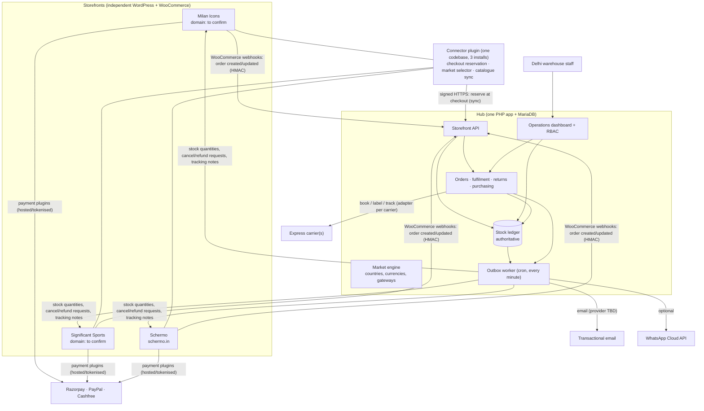
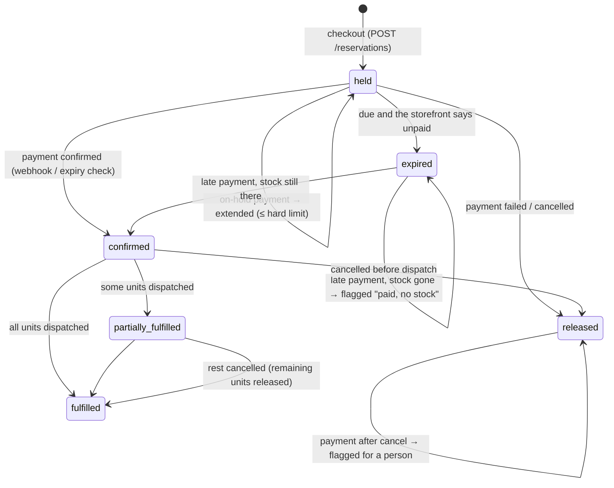
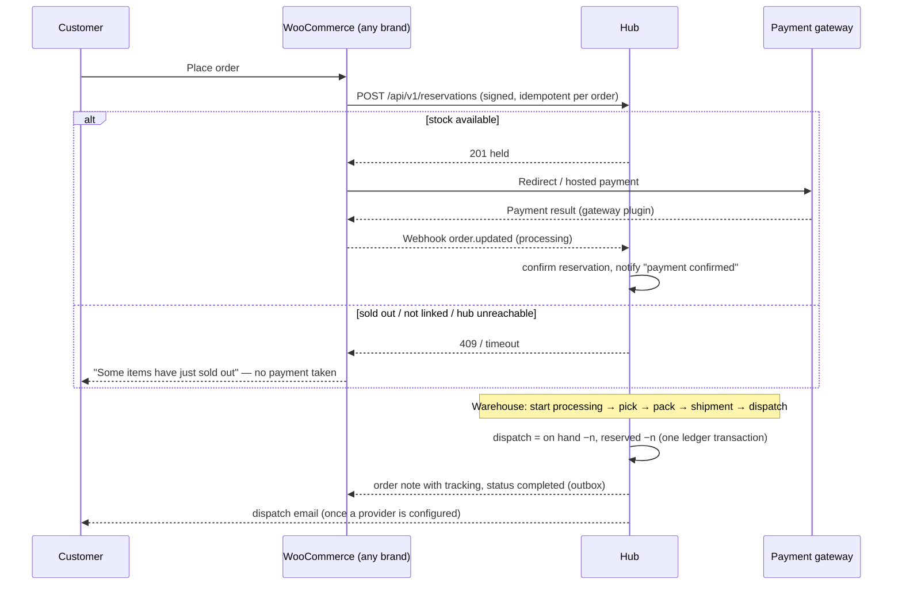

# 01 · Architecture

Status key used throughout: **Built** (code + passing tests) · **Written** (code, not run against the real service) · **Designed** (not built) · **Decision needed** (client/adviser input).

## 1. What was found (Phase 1 audit, 29 Oct 2026)

| Source | Finding | Consequence |
|---|---|---|
| `Udyanshgulati/milan-icons-website` | Next.js 16 marketing site for Milan Icons, the Italia T10 cricket franchise (domain in its README: `milanicon.com`, pre-launch gate). Brand tokens: black `#0b0b0c`, gold `#dca745`, crimson, Duomo artwork, kit renders. **No shop, no WooCommerce.** | Brand assets reusable for the Milan Icons storefront. Domain to be confirmed by the client before use. |
| `Udyanshgulati/significant-sports` | **Empty repository.** Milan Icons content names the parent company "Significant Sports & Entertainment" with `significantsports.in`. | No brand assets yet; storefront domain unconfirmed. |
| Schermo | **No repository, no assets.** Domain given: `schermo.in`. | Art direction cannot be finalised without assets. |
| `Udyanshgulati/RLlogistics` (this repo) | Next.js marketing site for RL Logistics & Warehousing (New Delhi). Navy `#0B1F4D`, amber `#F2A900`, dashed route motifs. | Used only as visual inspiration for the dashboard's motion language. |
| WordPress / WooCommerce installs | **None found or provided.** | The storefronts, connector plugin and gateway set-up start from scratch on staging. |

## 2. Recommended architecture

The three storefronts stay independent WordPress + WooCommerce installs. One small **hub** (PHP + MariaDB, the same stack WooCommerce already needs) owns stock, orders, operations and integrations. No microservices, no message broker, no Redis requirement: background work runs from a database outbox driven by cron.

### Why not WordPress Multisite?
Multisite shares one users table and one plugin set across sites, couples upgrades and blast radius, and still does not give shared stock: WooCommerce stock lives per site. Independent installs plus one ledger keep brands isolated (separate customers, payment accounts, SEO) while stock is genuinely shared.

### Why the hub is not inside one storefront
Putting the ledger in, say, the Milan Icons install would make the other brands depend on that site's plugins, updates and traffic. The hub is small, has no storefront plugins, and can be locked down (no public sign-up, no theme code).

### Who owns what

| Data | Owner (source of truth) | Others receive it how |
|---|---|---|
| Physical stock, reservations, movements | **Hub ledger** | Storefronts get the available quantity pushed after every change (outbox, coalesced per listing). The checkout never trusts that copy: it reserves against the ledger. |
| Product copy, photos, prices, SEO | Each storefront | Hub stores only identity (SKU), shipping attributes, links. |
| Orders and payments | Storefront + its gateway | Hub mirrors orders from webhooks. Cancel/refund/mark-paid requests go back to the storefront; the hub changes state only when the storefront confirms. |
| Market rules (countries, currencies, gateways) | Hub `markets.json` (reviewed in git) | Storefronts fetch `GET /api/v1/markets` and cache it. |
| Customers | Each storefront | Hub keeps the minimum per order (name, email, phone, addresses) for fulfilment, behind the `orders.view_customer` permission; every view is audited. |

## 3. Components

| Component | What it does / why | Runs where | Stores | Connects to | Plugin? | Paid service? | Custom justified? | Est. cost | Failure modes → handling | Tested by |
|---|---|---|---|---|---|---|---|---|---|---|
| Stock ledger (`core/Inventory/Ledger`) | One authoritative record of every unit; atomic reservations | Hub | `stock_levels`, `stock_movements`, `reservations` | DB only | No | No | Yes — no plugin offers cross-store atomic reservations with this audit trail | Built | Deadlock → automatic retry; impossible change → refused with a staff-readable reason; DB CHECK constraints as a backstop | `LedgerTest`, `ConcurrencyTest` |
| Catalogue mapping (`Catalog`, `SkuPolicy`) | SKUs, six-size generator, explicit listing↔stock links | Hub | `products`, `inventory_items`, `listings` | — | No | No | Yes (core requirement) | Built | Duplicate SKU, cross-brand or SKU mismatch → needs explicit confirmation | `CatalogTest` |
| Order sync (`OrderSync`) | Mirrors WooCommerce orders; drives ledger transitions | Hub | `orders`, `order_lines`, `order_events`, `inbox_events` | WooCommerce webhooks | Native WooCommerce webhooks | No | Yes | Built | Duplicate → ignored; older event → ignored; failure → recorded, retry from Integration health | `OrderFlowTest`, `HttpTest` |
| Expiry worker | Lets unpaid holds go only after asking the storefront | Hub (cron) | — | WooCommerce REST | No | No | Yes | Built | Store unreachable → keeps holding until the hard limit, then flags | `ExpiryAndSignatureTest` |
| Outbox worker | Retries everything outbound with backoff; dead letters visible | Hub (cron) | `outbox` | Stores, email, carriers | No | No | Yes (replaces a queue server) | Built | 8 attempts (1 min → 1 h), then "dead" with a human explanation and Retry | `OutboxTest` |
| Fulfilment + returns + purchasing | Pick/pack/ship/dispatch, partial shipments, inspection before resale, POs | Hub | `shipments`, `returns`, `purchase_orders`… | Ledger | No | No | Yes | Built | Invalid step → refused; double clicks → no-ops | `OrderFlowTest`, `PurchasingTest` |
| Dashboard + RBAC | Daily operations UI | Hub | `users`, `user_roles`, `audit_log`, `saved_views` | — | No | No | Yes (requirement) | Built | Forbidden → 403 with explanation; CSRF → 419 | `HttpTest`, browser checks |
| Storefront API | Signed checkout reservations, webhooks, market config | Hub | `rate_limits` | Connectors | No | No | Yes | Built | Bad signature → 401; unknown product → 409 + queued for linking; fail closed | `HttpTest` |
| Market engine | Country resolution, display vs checkout currency, gateway eligibility, availability | Hub library; storefront consumes config | `fx_rates`, `market_prices` | ECB rates | Possibly WCML (free) later for multi-currency checkout | No | Yes for rules; reuse plugin for charging other currencies | Built (library) | No verified gateway → no checkout rather than a fake one; stale rates → base currency | `MarketTest` |
| Carrier adapters | Rates, booking, labels, tracking | Hub | `shipments`, `tracking_events` | DHL / FedEx / UPS / aggregator APIs | Avoid per-site shipping plugins | Carrier account | Yes (one adapter per chosen carrier) | Designed; selector built | API down → "rates unavailable", never an invented price | `ExpressSelectorTest` (fixtures) |
| Notification engine | Brand templates, delivery log, bounces | Hub | (to add: `notifications`) | Email provider, WhatsApp | No | Email + WhatsApp usage | Yes (templates/routing); provider is bought | Designed | Provider down → retried; bounces → suppression | Pending |
| Connector plugin | Checkout reservation, disables WooCommerce's own stock reduction, market selector, catalogue sync | Each storefront | Transients only | Hub API | It *is* a small custom plugin | No | Yes | Designed | Hub unreachable → checkout refused (fail closed) | Pending staging |
| Storefront themes | Premium per-brand storefronts | Each storefront | — | — | One custom parent theme + 3 child themes | No | Yes (design brief) | Designed | — | Pending |

## 4. The inventory decision

The three cases in the brief map to the data model as follows. **Nothing is ever linked automatically.**

| Case | How it is modelled | Who can create it |
|---|---|---|
| 1. Physically shared across storefronts | One `inventory_item` (one SKU per size) with several `listings` (one per storefront product/variation). Every store's checkout reserves from the same row. | `mapping.manage`, with an explicit "this will share stock between brands" confirmation (audited). |
| 2. Exclusive to one brand | One item, one listing (or several listings in the same brand's store). | `mapping.manage`. |
| 3. Same warehouse, owned or allocated separately | **Separate items with separate SKUs**, even if the garments are identical. Each item has an `owner_brand_id`. | `products.manage`. Ring-fenced *quantities* of one SKU per brand (allocations) are a possible later extension; not built, because a separate SKU already gives clean ownership. |

Every product shows one of three badges: **Shared across brands**, **One storefront**, **Not linked yet**. An exact SKU match between a storefront product and a central SKU is shown as a *suggestion* only.

### Stock buckets

`on_hand` counts every physical unit. Holds inside it: `reserved` (open orders), `damaged`, `quarantine` (returns awaiting inspection).
**Available = on hand − reserved − damaged − awaiting inspection.** Incoming (open purchase orders) is shown but never available.
The database enforces `reserved + damaged + quarantine ≤ on_hand` and all buckets ≥ 0 with CHECK constraints; `stock_movements` is append-only via triggers.

## 5. Lifecycles

### Reservation state machine

Timings (configurable): unpaid hold due for checking after **45 min**; hard limit **48 h**; WooCommerce's own "Hold stock" set to **30 min** so the storefront cancels abandoned orders first. A delayed webhook never releases stock by itself: the expiry worker asks the storefront for the order's status before releasing, and keeps holding while the storefront is unreachable.

### Order flow

## 6. Storefront integration map (connector plugin design)

The connector is the only custom code inside WordPress. It must be verified on staging against the exact WooCommerce version installed; hook names below are from WooCommerce's public API and are **not yet tested in this project**.

| Concern | Mechanism | Notes / limitations |
|---|---|---|
| Reserve at checkout | Classic checkout: `woocommerce_checkout_order_created`. Block checkout: `woocommerce_store_api_checkout_order_processed`. Call `POST /api/v1/reservations`; on anything but 200/201, throw to stop the checkout. | Fail closed: if the hub is down, no sale. Both hooks run before payment. Must confirm the error is shown to the customer and no payment is attempted in both checkouts. |
| Stop WooCommerce changing stock itself | `woocommerce_can_reduce_order_stock` and `woocommerce_can_restore_order_stock` return false. Keep "Manage stock" on so the hub's pushed quantity hides sold-out products. | Otherwise stock would be deducted twice (WooCommerce + hub). |
| Abandoned checkouts | WooCommerce "Hold stock (minutes)" = 30. | Woo cancels → webhook → hub releases. Hub expiry is the safety net. |
| Order events to the hub | Native WooCommerce webhooks: *Order created*, *Order updated* → `/api/v1/webhooks/woocommerce/{store}` with a secret. | WooCommerce disables a webhook after repeated failed deliveries; the hub shows each store's last contact on Integration health. A scheduled pull of recently modified orders (`GET /orders?modified_after=`) is planned as the backstop (not built). |
| Order metadata | Connector writes `commerce_reservation_key`, `commerce_display_currency`, `commerce_market` (no leading underscore: WooCommerce hides `_`-prefixed meta from REST). | |
| Stock to storefronts | Hub → WooCommerce REST `PUT products/{id}` or `products/{id}/variations/{id}` with `stock_quantity`. | Coalesced: one pending push per listing; the push reads the quantity at send time. |
| Catalogue | Connector (or the hub via REST) registers every product/variation as a listing; staff link it once. | Unknown products at checkout are refused and appear under "not linked". |
| Cancel / mark paid / refund from the dashboard | Hub → REST (`PUT orders/{id}`, `POST orders/{id}/refunds` with `api_refund: true`). | Refunds run through the gateway plugin. A retried refund first searches for an existing refund carrying the return reference, so a lost response never refunds twice (`OutboxTest`). |
| Market selector, currency display | Connector reads the hub's market config; see doc 04. | |

## 7. Security boundaries
- Storefront → hub: per-store HMAC secret, 5-minute timestamp window, rate limit 1,200/min per store; WooCommerce webhooks verified with WooCommerce's own signature.
- Hub → storefront: WooCommerce REST keys for a dedicated user with read/write on products and orders only; keys in environment variables, never in the database or UI.
- Staff → hub: argon2id passwords, failed-attempt limits and lockout, session regeneration, HttpOnly/SameSite/Secure cookies, CSRF token on every form, strict CSP (no inline script or style), permission checks in every handler.
- See doc 06 for the full plan.
