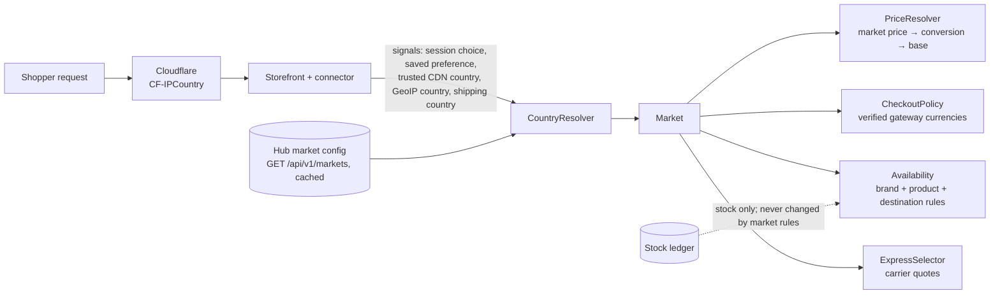

# 04 · Markets, geolocation and currency selection

Library: `core/src/Market/*` (**built and tested**). Configuration: `config/markets.example.json` (**placeholder values**). Storefront side (selector UI, cookie, checkout hooks) is part of the connector plugin (**designed, not built**).

## 1. Architecture

## 2. Country → currency table (starting configuration — approve before launch)

| Market | Countries | Display | Can be charged in (once a gateway verifies it) | Duties presentation |
|---|---|---|---|---|
| IN | India | INR | INR | Domestic GST inclusive |
| US | United States | USD | USD, INR | DAP: charged by carrier on delivery |
| GB | United Kingdom | GBP | GBP, INR | DAP |
| EUROZONE | AT BE BG CY DE EE ES FI FR GR HR IE IT LT LU LV MT NL PT SI SK (Bulgaria uses the euro from 1 Jan 2026) | EUR | EUR, INR | DAP |
| AE | United Arab Emirates | AED | AED, INR | DAP |
| INTL | Every other country | INR | INR | DAP |

Non-euro EU countries (e.g. SE, DK, PL, CZ, HU, RO) fall into INTL until a market is configured for them. All gateways start **disabled with no verified currencies**, so with the example file **no checkout currency is available** — deliberately (test `testNoVerifiedGatewayMeansNoCheckoutRatherThanAFakeOne`).

## 3. Selection and persistence logic

Browsing: **this session's explicit choice → (development only) `?market_country=` override → saved preference (account or long-lived cookie) → trusted CDN country → GeoIP country → default market + selector shown.**

- An explicit choice is never replaced by an inferred one. If the inferred market differs, the shopper sees one dismissible banner ("Shopping from the United States? View prices in USD"); once dismissed it is not shown again that session.
- Codes that are not countries (`XX`, `T1` Tor, `A1`/`A2` proxies, `EU`, `AP`, `ZZ`) count as unknown.
- **At checkout the shipping country decides the market**, whatever was browsed; if it differs, the cart is re-priced and the shopper is told before paying (`repriceRequired`).
- Persistence: a signed, HttpOnly cookie holding only the country code (no IP, no city); logged-in shoppers can save it to their account. Detection is skipped when a valid cookie exists.
- The development override is ignored unless explicitly enabled outside production (`CountryResolver(…, allowDevOverride)`).

## 4. Payment and shipping eligibility rules

- Checkout currency = display currency if it is listed for the market **and** at least one enabled gateway has it in `verified_currencies` for the destination; otherwise the next listed currency, with a notice shown before payment; otherwise **no online checkout** with a contact message. The currency is never changed after payment.
- Gateways are hidden when disabled, unverified for the currency, not allowed for the destination (e.g. PayPal excluded for India), or excluded for the brand.
- Product availability: brand-level disabled markets, destination allowlist, per-product allow/block lists. Never alters stock; stock comes from the ledger.
- Shipping: express quotes only; non-express shown only if the business enables it and labelled as slower; carrier failure shows "rates unavailable", never a price.

## 5. Tax and duties dependencies
Rules per market (`tax_display`, `duties.mode` and message) are placeholders until approved by the client's tax adviser (doc 03 §6). DDP is never shown unless the carrier contract supports it.

## 6. Privacy and security
- Data used: country code only (from Cloudflare's `CF-IPCountry` or WooCommerce's built-in MaxMind GeoLite2 lookup, which needs a free MaxMind licence key). No GPS, no browser location permission, no city/postcode until the shopper types an address at checkout.
- The CDN header is trusted only when the request comes from Cloudflare's published IP ranges (nginx `set_real_ip_from` + `real_ip_header CF-Connecting-IP`); otherwise it is ignored.
- Retention: the market cookie (country code) for 12 months; nothing about inferred location is stored on orders except the market and display currency used; IPs are not exposed through any API or page.
- Spoofing a market cannot unlock products or prices: availability, price and tax are re-evaluated on the shipping destination at checkout.

## 7. Test matrix (brief §16)

| # | Scenario | Status | Test |
|---|---|---|---|
| 1–4 | India / US / UK / EU visitor | Passed | `MarketTest::testVisitorsFromIndiaUsUkAndEuGetTheirMarkets` |
| 5 | VPN (inferred ≠ chosen) | Passed | `testManualChoiceWinsAndVpnMismatchOnlySuggests` |
| 6 | Location unknown | Passed | `testUnknownLocationFallsBackToTheDefaultAndShowsTheSelector` |
| 7 | Manual country change | Passed | `testManualChoiceWinsAndVpnMismatchOnlySuggests` |
| 8 | Returning visitor with saved preference | Passed | `testReturningVisitorKeepsSavedPreference` |
| 9 | Shipping address ≠ inferred country | Passed | `testShippingAddressDecidesTheOrderMarket` |
| 10 | Unsupported checkout currency | Passed | `testUnsupportedCheckoutCurrencyFallsBackAndTellsTheShopper` |
| 11 | Exchange-rate feed failure | Passed | `testRatesAreConvertedThenWithheldWhenTheFeedFails` |
| 12 | Shipping-rate API failure | Passed | `ExpressSelectorTest::testCarrierFailureNeverProducesAPrice` |
| 13 | No eligible express service | Passed | `testNoExpressServiceIsNeverSilentlyDowngraded` |
| 14 | Product unavailable in a market | Passed | `testBrandSpecificMarketRestrictions` |
| 15 | Cart recalculation after country change | **Pending** — needs the storefront connector | — |
| 16 | Correct currency in confirmation email | **Pending** — needs the notification engine | — |
| 17 | Historical order currency unchanged | Passed (orders store currency + minor units; nothing re-converts) | `OrderFlowTest`, `MarketTest::testCurrencyMinorUnitsAreRespected` |
| 18 | Stock synchronisation across countries | Passed (one ledger, market rules never touch stock) | `ConcurrencyTest`, `OutboxTest` |
| 19 | Payment gateway failure | Passed for the hub side (failed payment releases stock) | `OrderFlowTest::testPaymentFailureAfterOrderCreationReturnsStock` |
| 20 | Currency change during checkout | **Pending** — needs the storefront connector | — |
